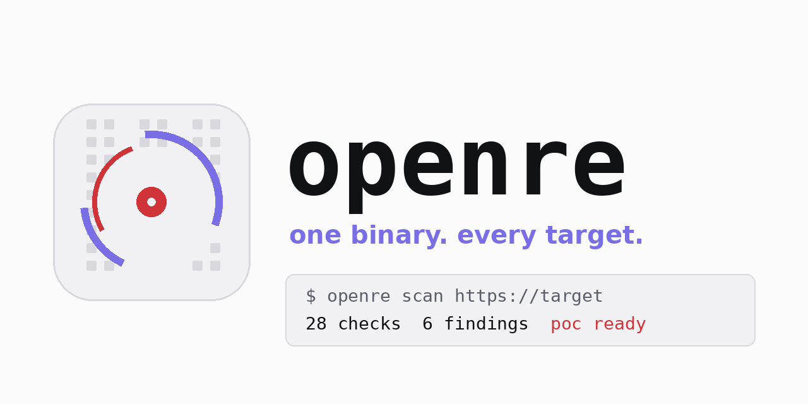
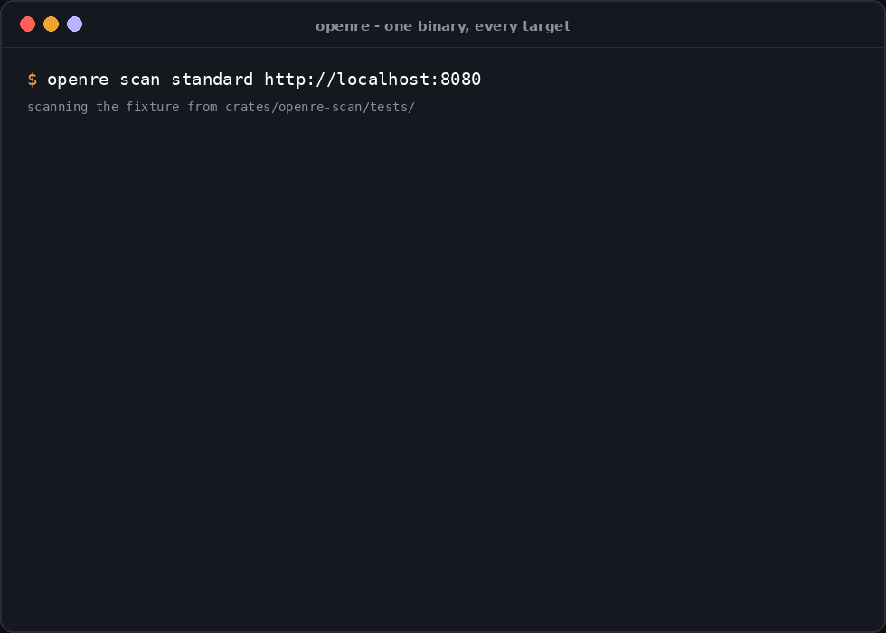
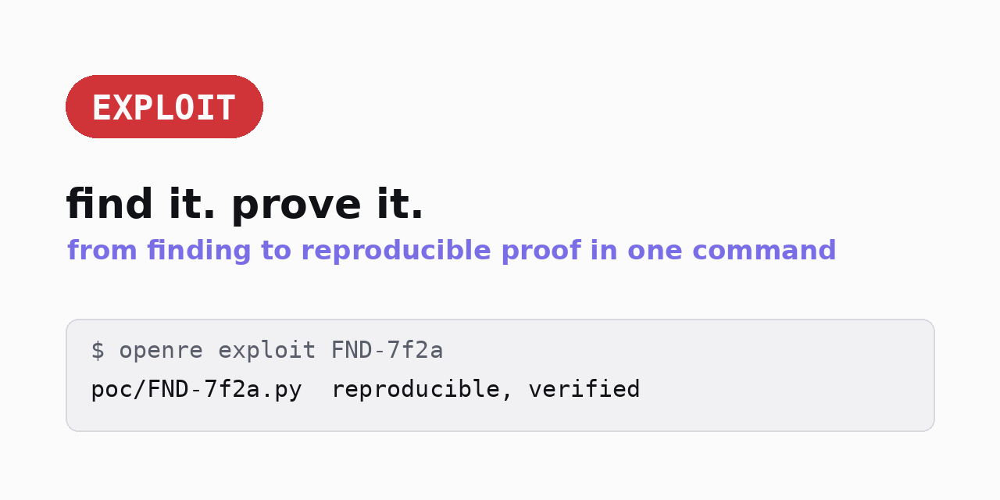
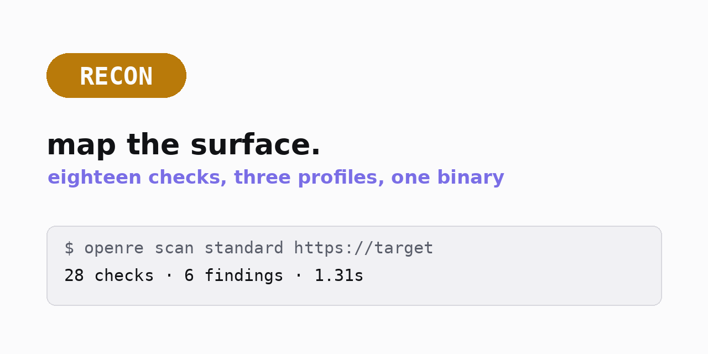
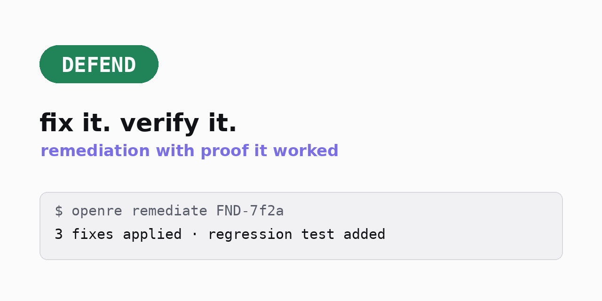
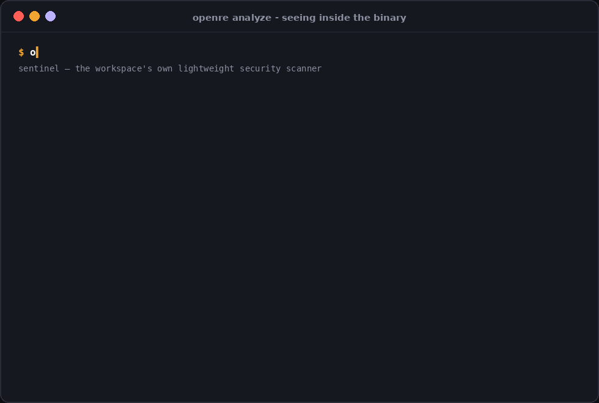
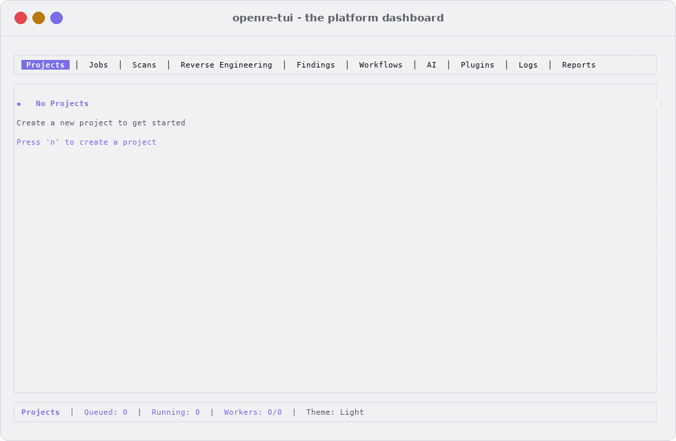
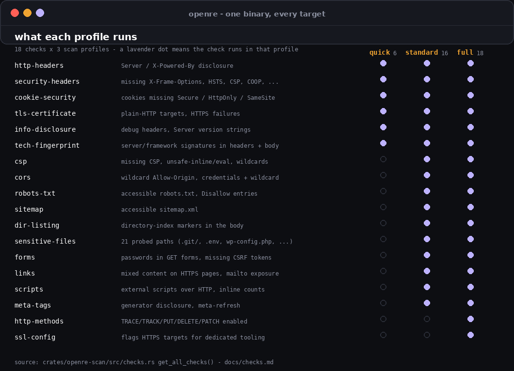
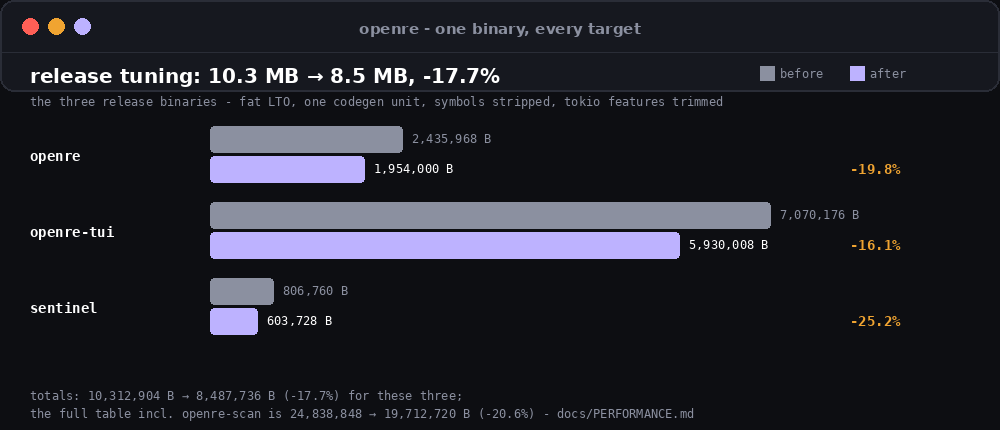
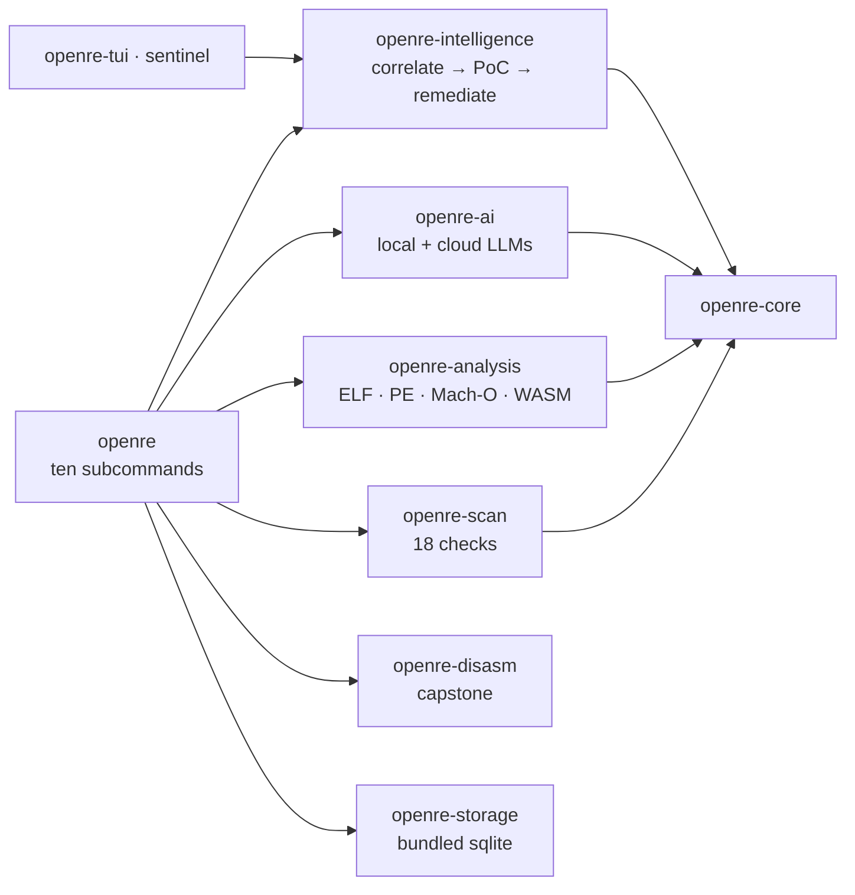

<div align="center">
  <picture>
    <source media="(prefers-color-scheme: dark)" srcset=".github/social-preview.png">
    
  </picture>
  <h1>openre</h1>
  <p><strong>Open-source reverse engineering &amp; offensive security platform</strong></p>
  <p>Scan websites and APIs · analyze any binary · generate PoCs · remediate — one static Rust binary</p>
  <p>
    <a href="https://github.com/RXVEN-1907/open-re/actions/workflows/ci.yml"></a>
    <a href="https://github.com/RXVEN-1907/open-re/releases/latest"></a>
    <a href="https://github.com/RXVEN-1907/open-re/releases/latest"></a>
    <a href="LICENSE"></a>
    <a href="https://www.rust-lang.org"></a>
  </p>
</div>

---

**One binary, zero dependencies.** Point `openre` at a website and it runs
18 security checks, fingerprints the stack, and hands you findings with
severity and evidence. Point it at a binary — ELF, PE, Mach-O, or WASM —
and it reads metadata, symbols, imports, sections, and disassembles
functions down to hex bytes. Wire in an LLM (local Ollama/llama.cpp/ONNX or
cloud OpenAI/Anthropic/vLLM) and it correlates findings, drafts PoC
exploits, and verifies remediation. With no LLM configured, everything
except `ai chat` still works, and the tool tells you so honestly.

No database. No server. No Docker. SQLite is bundled; state lives in one
directory you own.

<div align="center"></div>

*Real output: a standard scan against the deliberately-vulnerable fixture
that ships in `crates/openre-scan/tests/` — 15 checks, 17 findings, 1.31
seconds.*

<details>
<summary><strong>Contents</strong></summary>

- [Quickstart](#quickstart)
- [Three workflows](#three-workflows)
- [Web &amp; API scanning](#web--api-scanning)
- [Binary analysis](#binary-analysis)
- [The AI layer](#the-ai-layer)
- [Scan diffing](#scan-diffing)
- [The terminal dashboard](#the-terminal-dashboard)
- [Performance](#performance)
- [How it compares](#how-it-compares)
- [Every command](#every-command)
- [CI/CD integration](#cicd-integration)
- [Releases](#releases)
- [FAQ](#faq)
- [Architecture](#architecture)

</details>

## Quickstart

Prebuilt binaries for Linux, Windows, macOS, and FreeBSD — unpack and run:

```console
$ openre scan standard https://your-target.example
$ openre analyze ./some-binary --format json
$ openre hunt --target https://your-target.example   # scan → correlate → PoC, one shot
```

Or from source (Rust stable):

```console
$ git clone https://github.com/RXVEN-1907/open-re.git && cd open-re
$ cargo build --release
$ ./target/release/openre --help
```

Shell completions ship in every release archive and via
`openre completions <bash|zsh|fish|powershell>`; the man page is
`docs/openre.1`.

## Three workflows

<div align="center">
  <table><tr>
    <td align="center" width="33%">
      <picture>
        <source media="(prefers-color-scheme: dark)" srcset="docs/mode-exploit.png">
        
      </picture>
    </td>
    <td align="center" width="33%">
      <picture>
        <source media="(prefers-color-scheme: dark)" srcset="docs/mode-recon.png">
        
      </picture>
    </td>
    <td align="center" width="33%">
      <picture>
        <source media="(prefers-color-scheme: dark)" srcset="docs/mode-defend.png">
        
      </picture>
    </td>
  </tr></table>
</div>

Scan (`recon`) finds the surface, `exploit` turns a finding into a
reproducible proof, `remediate` fixes it and adds the regression test —
each one command, each verified against the same finding store.

## Web & API scanning

Three profiles: `quick` (6 checks, CI-gate fast), `standard` (16 checks,
the everyday scan), `full` (18 checks, audit depth). Every check is an
independent pass — one that errors is logged and the scan continues.

```console
$ openre scan full https://target --checks sensitive-files,http-methods
$ openre scan standard https://target --format json --output scan.json
```

What the 18 checks actually look at:

| check | profile | detects |
|---|---|---|
| `http-headers` | quick+ | `Server` / `X-Powered-By` disclosure |
| `security-headers` | quick+ | missing `X-Frame-Options`, HSTS, CSP, `Referrer-Policy`, COOP, CORP, … |
| `cookie-security` | quick+ | cookies without `Secure`/`HttpOnly`/`SameSite` |
| `tls-certificate` | quick+ | plain-HTTP targets, TLS failures |
| `info-disclosure` | quick+ | debug headers (`X-Debug-Token`, `Via`, `X-Cache`, …), version strings |
| `tech-fingerprint` | quick+ | PHP, ASP.NET, nginx, IIS, WordPress, React, Vue, jQuery, … |
| `csp` | standard+ | missing CSP, `unsafe-inline`, wildcards |
| `cors` | standard+ | `ACAO: *` with credentials |
| `robots-txt` / `sitemap` | standard+ | reachable `/robots.txt`, `/sitemap.xml`, interesting entries |
| `dir-listing` | standard+ | directory-index markers |
| `sensitive-files` | standard+ | 21 probed paths: `.git/`, `.env`, `wp-config.php`, `docker-compose.yml`, … |
| `forms` | standard+ | passwords in GET forms, missing CSRF tokens |
| `links` / `scripts` / `meta-tags` | standard+ | mixed content, external HTTP scripts, generator meta |
| `http-methods` | full | enabled `TRACE`/`PUT`/`DELETE`/`PATCH` |
| `ssl-config` | full | HTTPS targets flagged for dedicated tooling |

Per-check filtering with `--checks` / `--exclude`, machine output with
`--format json|sarif|yaml`, pause/resume, and export/import of whole scans
(CSV/JSON). The full contract with behavior notes:
[`docs/checks.md`](docs/checks.md).

## Binary analysis

The `analyze` family reads four container formats and disassembles with
capstone:

```console
$ openre analyze ./sentinel info
$ openre analyze ./sentinel imports        # dynamic import names
$ openre analyze ./sentinel functions      # symbol table enumeration
$ openre analyze ./sentinel disasm --start 17fa0 --end 17fc0 --bytes
$ openre analyze ./sentinel pipeline       # identify → load → disassemble → cfg → dataflow
```

<div align="center"></div>

*Real output against the `sentinel` binary: 32 sections, 56 dynamic
imports, capstone instructions with hex bytes at the entry point.*

`info` reports format, architecture, entry point, and hardening flags;
`symbols`/`functions`/`imports`/`exports` enumerate what the container
carries; `cfg` and `dataflow` recover graphs for the analysis pipeline;
`decompile` reports honestly when no decompiler backend is wired. JSON for
every command.

## The AI layer

Local-first and off by default:

| type | providers |
|---|---|
| **local** | Ollama, llama.cpp, ONNX Runtime (CPU/CUDA/CoreML) |
| **cloud** | OpenAI, Anthropic, vLLM |
| **behavior** | nothing calls out unless you configure it; `ai providers` lists what's live |

```console
$ openre ai "analyze this function for vulnerabilities" --binary ./target
$ openre ai chat                       # interactive; says so plainly if no provider
$ openre exploit <finding-id>          # PoC from a finding
$ openre remediate <finding-id>        # plan + quick-fixes, verified against the KnowledgeBase
```

Exploit and remediation work with or without an LLM — the template engine
and knowledge base (CWE/CAPEC/OWASP references) are local. Providers,
caching, and privacy notes: [`docs/ai-providers.md`](docs/ai-providers.md).

## Scan diffing

Re-scan a target and ask the only question that matters — *what changed?*

```console
$ openre scan diff 7c1a41b0 a6a3f67c   # unambiguous id prefixes are enough
```

Three sections: **new** findings (in B, not A), **fixed** (in A, not B),
**severity changed** — with per-severity counts, or `--format json`.
Findings are matched by title + check identity, so re-runs diff cleanly.

## The terminal dashboard

`openre-tui` renders the whole platform as a ten-panel terminal
application (Projects · Jobs · Scans · Reverse Engineering · Findings ·
Workflows · AI · Plugins · Logs · Reports), and `sentinel` is a minimal
TUI scanner for constrained boxes.

<div align="center">
  <picture>
    <source media="(prefers-color-scheme: dark)" srcset="docs/tui.png">
    
  </picture>
</div>

## Performance

A single-digit-megabyte binary with fat-LTO tuning and a tokio feature set
trimmed from `full` to the eight features the code exercises:

<div align="center"></div>

<div align="center"></div>

| binary | before | after |
|---|---|---|
| `openre` | 2,435,968 B | 1,954,000 B (**−19.8%**) |
| `openre-tui` | 7,070,176 B | 5,930,008 B (**−16.1%**) |
| `sentinel` | 806,760 B | 603,728 B (**−25.2%**) |

Method and measurements: [`docs/PERFORMANCE.md`](docs/PERFORMANCE.md).

## How it compares

Against the tools it gets mentioned next to — and where they win, it says
so:

| dimension | openre | nmap | nuclei | radare2 |
|---|---|---|---|---|
| primary job | web/API scanning + binary analysis | network discovery | template-based vuln scanning | binary RE |
| AI layer | optional, local-first | none | none | separate plugin |
| binary analysis | symbols/imports/disasm/CFG pipeline | none | none | its whole point |
| dependencies | one binary, bundled SQLite | single binary + NSE | binary + templates repo | self-contained |
| license | MIT | GPL-2.0 | MIT | LGPL-3.0 |

nmap owns network mapping, nuclei owns template breadth, radare2 owns deep
RE — openre's claim is the scan-and-triage pass **plus** first-line binary
analysis in one dependency-free binary. The full table with sources:
[`docs/comparison.md`](docs/comparison.md).

## Every command

| command | what it does |
|---|---|
| `openre hunt` | scan → correlate → PoC in one shot, with a shareable HTML report |
| `openre scan quick\|standard\|full` | web/API security scans |
| `openre scan custom` | run specific checks with `--checks` / `--exclude` |
| `openre scan pause` / `resume` | control a running scan |
| `openre scan export` / `import` | move scans between machines (CSV/JSON) |
| `openre scan diff` | two scans → new / fixed / severity-changed |
| `openre analyze info\|symbols\|imports\|exports\|sections\|segments\|strings` | read a binary's structure |
| `openre analyze functions\|disasm\|cfg\|dataflow\|pipeline` | go deeper: symbols, capstone, graphs |
| `openre ai chat\|analyze` | ask an LLM, local or cloud |
| `openre exploit` | reproducible PoC for a finding |
| `openre remediate` | fix plan + quick-fixes + verification |
| `openre report` | generate and manage reports |
| `openre config` | show/validate/edit configuration |
| `openre queue` | local job store: submit, status, logs, cancel, retry, stats |
| `openre schedule` | recurring scans with baselines |
| `openre completions` | shell completions: bash, zsh, fish, PowerShell |

Every human view colors itself and respects
[`NO_COLOR`](https://no-color.org); every command has machine-readable
output. Flags per subcommand: [`docs/cli.md`](docs/cli.md) or the man page.

## CI/CD integration

```yaml
# GitHub Actions: scan a staging target, upload SARIF to code scanning
- name: Security scan
  run: |
    curl -L https://github.com/RXVEN-1907/open-re/releases/latest/download/openre-0.2.0-x86_64-unknown-linux-gnu.tar.gz | tar xz
    ./openre-0.2.0-x86_64-unknown-linux-gnu/openre scan quick https://staging.example.com \
      --format sarif --output results.sarif
- uses: github/codeql-action/upload-sarif@v3
  with:
    sarif_file: results.sarif
```

The SARIF contract: [`docs/sarif.md`](docs/sarif.md).

## Releases

Tag a version and the pipeline builds **17 artifacts**: Linux (x86-64
glibc/musl/32-bit, aarch64 glibc/musl, armv7/armv6, riscv64, loongarch64,
s390x), Windows (MSVC, GNU x86-64/32-bit, ARM64), macOS
(Apple silicon, Intel, universal2), and FreeBSD — each archive carries
`openre`, `openre-tui`, `sentinel`, and shell completions, staged
deterministically with a combined sha256 checksums file. The Windows and
macOS test suites run in CI on every push.

## FAQ

<details>
<summary><strong>Is this an nmap replacement?</strong></summary>

No — no host discovery, port scanning, or OS fingerprinting. openre reads
HTTP targets and local binary files. See the
[comparison](#how-it-compares).
</details>

<details>
<summary><strong>Does it phone home?</strong></summary>

No telemetry, ever. The only network traffic is the scans you point it at,
plus LLM calls if (and only if) you configure a cloud provider.
</details>

<details>
<summary><strong>What works without an API key?</strong></summary>

Everything except <code>ai chat</code>/<code>ai analyze</code>: scanning,
binary analysis, exploit templates, remediation plans, reports, diffing,
the TUI. The tool says so plainly instead of failing mysteriously.
</details>

<details>
<summary><strong>Where does state live?</strong></summary>

One directory you own: a bundled SQLite database for scans/findings/
queue/schedules, plus your <code>config.toml</code>. Delete it and openre
forgets everything.
</details>

<details>
<summary><strong>Is scanning legal?</strong></summary>

Only scan targets you own or have explicit written permission to test.
Unauthorized scanning may violate laws and terms of service.
</details>

## Architecture



Fourteen crates behind one front door — the full map with a paragraph per
crate: [`docs/architecture.md`](docs/architecture.md).

## Documentation

[`docs/cli.md`](docs/cli.md) ·
[`docs/checks.md`](docs/checks.md) ·
[`docs/architecture.md`](docs/architecture.md) ·
[`docs/ai-providers.md`](docs/ai-providers.md) ·
[`docs/sarif.md`](docs/sarif.md) ·
[`docs/PERFORMANCE.md`](docs/PERFORMANCE.md) ·
[`docs/comparison.md`](docs/comparison.md) ·
[`docs/INSTALLATION.md`](docs/INSTALLATION.md) ·
[`docs/DEVELOPMENT.md`](docs/DEVELOPMENT.md) · man page `docs/openre.1`

## Contributing

CI gates formatting, clippy (`-D warnings`, all targets), and the full
test suite on Linux, Windows, and macOS. Add a check to
`crates/openre-scan/src/checks.rs`, add a tool, or pick something from the
issue tracker — see [CONTRIBUTING.md](CONTRIBUTING.md).

## License

MIT — see [LICENSE](LICENSE).
