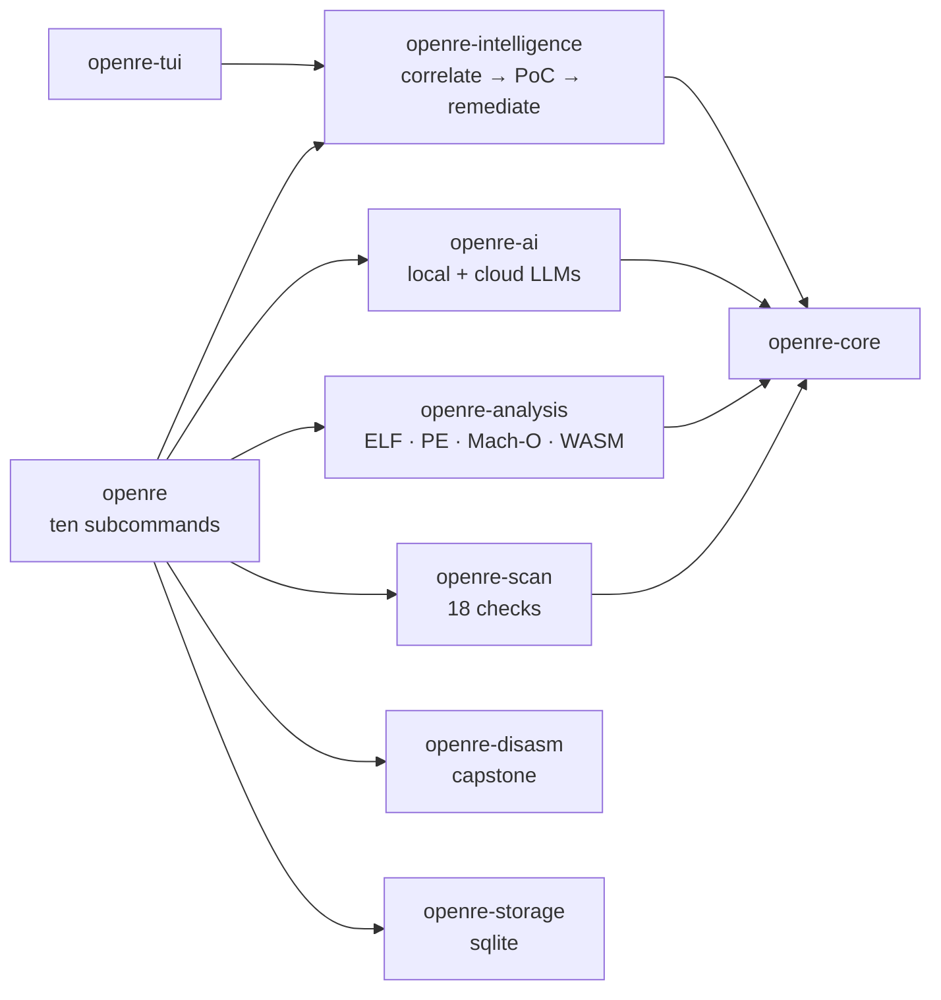

<div align="center">
  <picture>
    <source media="(prefers-color-scheme: dark)" srcset=".github/social-preview.png">
    
  </picture>
  <h1>openre</h1>
  <p><strong>Open-source reverse engineering &amp; offensive security platform</strong></p>
  <p>
    <a href="https://github.com/RXVEN-1907/open-re/actions/workflows/ci.yml"></a>
    <a href="https://github.com/RXVEN-1907/open-re/releases/latest"></a>
    <a href="https://github.com/RXVEN-1907/open-re/releases/latest"></a>
    <a href="LICENSE"></a>
    <a href="https://www.rust-lang.org"></a>
  </p>
</div>

---

Modern security tooling + LLMs, compiled into **one static binary**: scan
websites and APIs for vulnerabilities, analyze any binary (ELF, PE, Mach-O,
WASM) down to its control-flow graph, correlate findings with an AI research
layer, generate reproducible PoC exploits, and get actionable remediation —
no database, no server, no Docker, no external dependencies. Works like
`nmap`: download it, point it at a target, read the answer.

<div align="center"></div>

*Real output: a standard scan against the deliberately-vulnerable fixture
that ships in `crates/openre-scan/tests/` — 15 checks, 17 findings, 1.31s.*

## One tool, three lights

Lavender is the soul of openre — it is on every screen. Each **mode** pairs
it with exactly one accent; the three never share a screen:

<div align="center">
  <table><tr>
    <td align="center" width="33%">
      <picture>
        <source media="(prefers-color-scheme: dark)" srcset="docs/mode-exploit.png">
        
      </picture>
      <strong>EXPLOIT</strong> · crimson<br>
      <sub>reproducible PoC generation</sub>
    </td>
    <td align="center" width="33%">
      <picture>
        <source media="(prefers-color-scheme: dark)" srcset="docs/mode-recon.png">
        
      </picture>
      <strong>RECON</strong> · amber<br>
      <sub>scanning and fingerprinting</sub>
    </td>
    <td align="center" width="33%">
      <picture>
        <source media="(prefers-color-scheme: dark)" srcset="docs/mode-defend.png">
        
      </picture>
      <strong>DEFEND</strong> · slate green<br>
      <sub>remediation and hardening</sub>
    </td>
  </tr></table>
</div>

## Quickstart

Prebuilt binaries for Linux, Windows, macOS, and FreeBSD — unpack and run:

```console
$ openre scan standard https://your-target.example
$ openre analyze ./some-binary --format json
$ openre hunt --target https://your-target.example   # one command: scan → correlate → PoC
```

Or build from source (Rust stable):

```console
$ git clone https://github.com/RXVEN-1907/open-re.git && cd open-re
$ cargo build --release
$ ./target/release/openre --help
```

## What it does

**Web & API scanning** — 18 security checks across three profiles, from a
2-second CI gate to a full audit, with SARIF output for GitHub code
scanning:

```console
$ openre scan quick https://target --format sarif --output results.sarif
```

| check | quick | standard | full |
|-------|:-----:|:--------:|:----:|
| HTTP headers, security headers, cookies, TLS cert | ✅ | ✅ | ✅ |
| information disclosure, technology fingerprinting | ✅ | ✅ | ✅ |
| CSP analysis, CORS, robots.txt, sitemap.xml | | ✅ | ✅ |
| directory listing, sensitive files (20+ paths) | | ✅ | ✅ |
| form, link, script, and meta-tag analysis | | ✅ | ✅ |
| HTTP methods, SSL/TLS configuration | | | ✅ |

**Binary analysis** — format identification, metadata, symbols, imports and
exports, sections and segments, string extraction, and capstone
disassembly down to functions and ranges; CFG and dataflow recovery in the
analysis pipeline:

```console
$ openre analyze ./binary symbols     # 193k symbols parsed from the openre binary itself
$ openre analyze ./binary disasm --function main
$ openre analyze ./binary pipeline    # identify → load → disassemble → cfg → dataflow
```

**AI research layer** — local-first (Ollama, llama.cpp, ONNX Runtime) with
cloud fallback (OpenAI, Anthropic, vLLM). The CLI is honest about it: with
no provider configured, `openre ai chat` says so and everything else stays
fully functional. When one *is* configured:

```console
$ openre ai "analyze this function for vulnerabilities" --binary ./target
$ openre exploit <finding-id>      # reproducible PoC for a finding
$ openre remediate <finding-id>    # fix guidance, verified against the KnowledgeBase
```

**All ten subcommands**: `hunt` (scan → correlate → PoC in one shot) ·
`scan` · `analyze` · `ai` · `exploit` · `remediate` · `report` ·
`config` · `queue` · `schedule` — plus `completions` for
bash/zsh/fish/PowerShell. Every human table colors itself (lavender, one
accent) and respects `NO_COLOR`; every command has machine-readable
output. Full reference: [`docs/cli.md`](docs/cli.md).

## Lean by design

One binary, ~2 MB, no runtime dependencies. The release profile is tuned
fat: LTO across the workspace, one codegen unit, symbols stripped, and
tokio's feature set trimmed from `full` to the features the code actually
exercises — measured, not vibes:

| binary | before | after |
|---|---|---|
| `openre` | 2,435,968 B | 1,954,000 B (**−19.8%**) |
| `openre-tui` | 7,070,176 B | 5,930,008 B (**−16.1%**) |
| `sentinel` | 806,760 B | 603,728 B (**−25.2%**) |
| resolved tokio features | 22 | 18 |

Numbers and method: [`docs/PERFORMANCE.md`](docs/PERFORMANCE.md). The
companion `openre-tui` renders the whole platform as a 10-panel terminal
dashboard, and `sentinel` is a minimal TUI scanner for constrained boxes.

## Architecture



Fourteen crates behind one front door — the map, crate by crate:
[`docs/architecture.md`](docs/architecture.md).

## Releases

Tag a version and the pipeline builds **17 artifacts**: Linux (x86-64
glibc/musl/32-bit, aarch64, armv7/armv6, riscv64, loongarch64,
powerpc64le, s390x), Windows (MSVC + GNU, x86-64/32-bit/ARM64), macOS
(aarch64, x86-64, universal2), and FreeBSD — each a self-contained archive
with shell completions, published with a combined sha256 checksums file.
Windows and macOS test suites run in CI on every push.

## Documentation

[`docs/architecture.md`](docs/architecture.md) ·
[`docs/cli.md`](docs/cli.md) ·
[`docs/checks.md`](docs/checks.md) ·
[`docs/ai-providers.md`](docs/ai-providers.md) ·
[`docs/sarif.md`](docs/sarif.md) ·
[`docs/PERFORMANCE.md`](docs/PERFORMANCE.md) ·
[`docs/DEVELOPMENT.md`](docs/DEVELOPMENT.md)

## Contributing

The workspace builds with `cargo build --release`; CI gates fmt, clippy
(`-D warnings`, all targets), and the full test suite on three operating
systems. See [CONTRIBUTING.md](CONTRIBUTING.md).

## License

MIT — see [LICENSE](LICENSE).

## Security

Only scan targets you own or have explicit written permission to test.
Unauthorized scanning may violate laws and terms of service. No telemetry.
No data collection. Ever.
