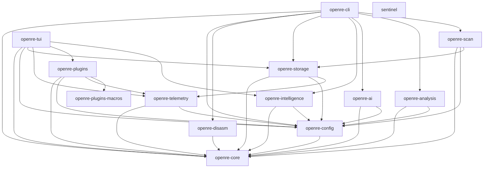
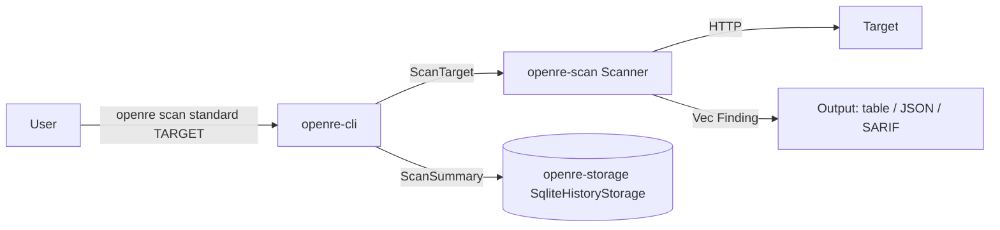

# Architecture

open-re is a Rust workspace of 14 crates. `openre-cli` is the front door; the engines behind it are library crates layered on `openre-core` types and `openre-config`.

## Crate graph

`openre-disasm` is a library consumed by `openre-cli`. `sentinel` is standalone: no internal dependencies, a separate minimal scanner binary.

## Workspace members

| Crate | Description (from its `Cargo.toml`) |
| --- | --- |
| `openre-core` | Core types, errors, and traits. Finding/Evidence/Severity/Confidence/Category, typed IDs, history records, remediation and reporting types, plugin trait definitions. Every other crate builds on these types. |
| `openre-config` | Configuration management. Layered `Config` (figment-backed TOML/env/JSON/YAML) covering storage, queue, plugins, AI, telemetry sections with defaults and validation. |
| `openre-scan` | Lightweight standalone security scanner. 18 built-in web checks (`checks.rs`), scan profiles (quick/standard/full), reqwest client builder, table/JSON/SARIF output, `run_scan` entry point. See [checks.md](checks.md) and [sarif.md](sarif.md). |
| `openre-analysis` | Binary analysis pipeline. A nine-stage DAG (identification, loading, disassembly, control flow, data flow, type recovery, decompilation, AI enrichment, finalization) executed by an orchestrator with per-stage outputs serialized between stages. Format loaders for ELF, PE, Mach-O, and WASM live under `binary/`. |
| `openre-ai` | AI service: providers, prompts, tools. A `ModelProvider` trait with llama.cpp, ONNX Runtime, and remote (OpenAI/Anthropic/vLLM/OpenAI-compatible) implementations, a `ModelRouter` that selects providers, plus caching, prompt compilation, redaction, and tool definitions. See [ai-providers.md](ai-providers.md). |
| `openre-intelligence` | Intelligence layer: finding correlation, CVE matching, dependency analysis, CWE/OWASP/CAPEC knowledge base, root-cause analysis, scan diffing, attack-path analysis, verification, risk scoring, investigation workflow engine, and agents. |
| `openre-cli` | The `openre` binary. Parses arguments (clap derive), builds a `Context` (config, storage, AI service), and dispatches to command modules for hunt, scan, analyze, ai, exploit, remediate, report, config, queue, and schedule. See [cli.md](cli.md). |
| `openre-tui` | Full-screen interactive TUI (ratatui/crossterm) with panels for projects, jobs, scans, reverse engineering, findings, workflows, plugins, logs, and reports. Engine integrations are feature-gated behind a `full` default and ride on `openre-scanner`, `openre-plugins`, `openre-telemetry`, `openre-intelligence`, and `openre-storage`. |
| `openre-plugins` | Plugin system: manifest parsing, registry, runtime, WASM sandbox (wasmtime, fuel/memory/time limits), lifecycle management, security controls, plus the built-in injection-testing and web-security plugin suites under `injection/` and `security/`. |
| `openre-plugins-macros` | Procedural macros for `openre-plugins` (plugin registration/boilerplate). |
| `openre-telemetry` | Logging, metrics, tracing, and audit logging, initialized from `Config::telemetry`. |
| `sentinel` | Lightweight TUI security scanner. A separate minimal binary wrapping a scan-and-report loop; no workspace dependencies. |
| `openre-disasm` | Multi-architecture disassembly on Capstone: x86, x86_64, ARM, AArch64, MIPS, RISC-V, PowerPC, SPARC, BPF, EVM. Control-flow graphs, dominator/loop analysis, function/stack-frame reconstruction, and an IR lifter. |
| `openre-storage` | Storage abstractions: SQLite-backed scan/project history (`SqliteHistoryStorage`), project store (symbols, xrefs, functions, instructions), global store, binary object store, and a migration manager. |

## Layering rules

- `openre-core` depends on nothing internal. Shared vocabulary types live here so downstream crates can interoperate without cycles.
- `openre-config` depends only on `openre-core`; it is the single source of runtime configuration.
- Engine crates (`openre-scan`, `openre-analysis`, `openre-ai`, `openre-intelligence`, `openre-plugins`) depend on `openre-core` + `openre-config`; `openre-disasm` depends on `openre-core` alone. None of them depend on each other.
- `openre-cli` and `openre-tui` are the only crates that combine engines. `openre-cli` depends directly (non-optionally) on `openre-core`, `openre-config`, `openre-scan`, `openre-analysis`, `openre-ai`, `openre-intelligence`, `openre-storage`, and `openre-disasm`, and its binary target is named `openre`. `openre-tui` gates `scanner` (the `openre-scanner` engine), `plugins`, `telemetry`, `intelligence`, and `storage` behind its `full` default.

## Non-member crates

Three crate directories exist in `crates/` but are not workspace members yet: `openre-recon` (reconnaissance plugins), `openre-scanner` (an earlier plugin-based scanning engine), and `openre-security-ai` (analysis layer over scanner findings). `openre-tui` references `openre-scanner` as an optional path dependency. Check `Cargo.toml` `members` for the current membership.

## Data flow: a web scan

The CLI scan command writes a `ScanSummary` to SQLite before, during (per-check progress), and after the run, so `scan pause`/`resume`/export work across invocations. Findings stream in as each check completes; failures of individual checks are logged and skipped, not fatal.

## Data flow: binary analysis

Each stage is a `PipelineStage` that declares its dependencies by `StageId`; the orchestrator (`openre-analysis::Orchestrator`) executes the DAG and serializes each stage's output into the next stage's context. The `analyze pipeline --stages` flag selects a subset of this DAG.
